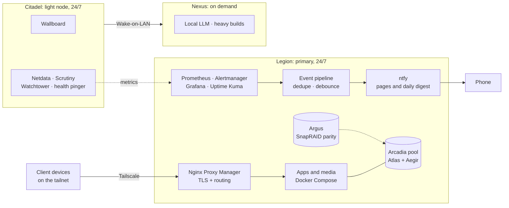

# Homelab

A self-hosted, three-node homelab that I design, run and document like a small production environment: Docker Compose stacks, a zero-trust network model built on Tailscale, a pooled and parity-protected storage layer, an alerting pipeline that pages only when it matters, and a written record of why things are the way they are.

This repository is the sanitized public view of my private infrastructure repo. Real IPs, domains, credentials and personal data are replaced with placeholders. Everything else (configs, scripts, runbooks, decision records) is the real thing, taken from what is running.

> **Status:** being published in phases. The structure and overview are up first. Configs, scripts and docs follow. See [Roadmap](#roadmap).

## Machines

| Name | Role | Hardware | Availability |
|---|---|---|---|
| **Legion** | Primary server: reverse proxy, media, photos, files, monitoring, DNS/ad-blocking, home automation | Lenovo Legion, Intel i5-9300H (4c/8t), GTX 1650, Ubuntu Server | 24/7 |
| **Citadel** | Light appliance: status wallboard, Wake-on-LAN/control scripts, secondary monitoring | HP laptop, Intel i3-8145U (2c/4t), Arch-based Linux | 24/7 |
| **Nexus** | On-demand workstation: heavy builds and a local LLM host | Desktop PC, RTX 5070 Ti, 32 GB RAM | Powered on for specific tasks |

Storage is named too. **Atlas** and **Aegir** are two data disks pooled with mergerfs as **Arcadia**. **Argus** is a separate parity disk (SnapRAID). The details are in [docs/architecture.md](docs/architecture.md).

## Architecture at a glance



A short version of the security model: the public DNS name for my services resolves to a **Tailscale address**, not a public one. That address range isn't routable on the internet, so a service is reachable only from a device already on the tailnet. There are no open inbound ports for the web services. Adding a new service is gated by construction.

## What's worth a look

- **Alerting that doesn't cry wolf.** Prometheus and Uptime Kuma feed one event pipeline that debounces and de-duplicates, then delivers to ntfy: rare, deterministic pages plus a morning health digest. There is also a path that pages when Citadel itself stops responding.
- **Storage with a real failure story.** mergerfs pool, SnapRAID parity, guarded automounts that check disk UUIDs before mounting, backup verification with checksums, and a documented restore path.
- **Decision records.** Twenty-two short records in `docs/decisions/` covering CPU undervolting, HDD power management, SSH hardening, why reverse-proxy redundancy was rejected, backup incidents, wallboard design and more. Each one has the evidence behind the call.
- **Runbooks and known issues.** Repeatable operations and recovery steps, plus an honest list of accepted risks and deliberate non-fixes.
- **Custom software.** A native status wallboard (Python and systemd), an event-routing service, Home Assistant integrations, and storage and backup automation.
- **Local LLM host.** GPU offload tuning and model evaluation notes for the on-demand workstation.

## Repository layout

```text
.
├── docs/            architecture, decision records, runbooks, host and service notes
├── compose/         Legion's Docker Compose stacks, split by category
├── citadel/         Citadel's Compose stack, wallboard source, systemd units
├── hosts/           per-host system config (systemd, udev, fstab, SnapRAID)
├── scripts/         automation: backups, alerting, storage, monitoring
└── tools/           small standalone helpers
```

Each directory has its own README describing what belongs there.

## Conventions

- **Compose is split by category** and combined through `COMPOSE_FILE`, so each file stays small and reviewable.
- **Secrets never live in Git.** Compose reads a local `.env`; this repo ships `.env.example` files with keys only.
- **Check actual state before asserting anything.** Several records here exist because an assumption turned out to be wrong. That habit is written down in the decisions.
- **Manual over automatic on the gateway path.** Anything that could take the whole homelab offline at once, such as reverse-proxy failover, is a runbook with a human in the loop and not automation.
- **Sweet spot, not extremes.** Tuning decisions such as undervolting, disk spin-down and read-ahead go for a measured middle value backed by data.

## Roadmap

| Phase | Content | Status |
|---|---|---|
| 1 | Repository structure, README, license | done |
| 2 | Architecture doc and decision records | done |
| 3 | Runbooks, host and service notes, known issues | in progress (runbooks up) |
| 4 | Compose stacks and monitoring configuration | planned |
| 5 | Scripts and tools | planned |
| 6 | CI: shellcheck, yamllint, `docker compose config`, secret scanning | planned |

## How this is built

I use AI coding assistants to help draft configs, scripts and documentation. Changes are checked against the live systems before they are recorded, and the decision records capture what was measured and what went wrong, including my own mistakes.

## License

[MIT](LICENSE). Configs are shared as reference. Adapt them to your own hardware and network, and don't paste them in blind.
