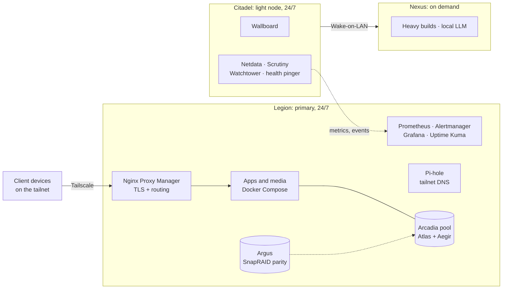
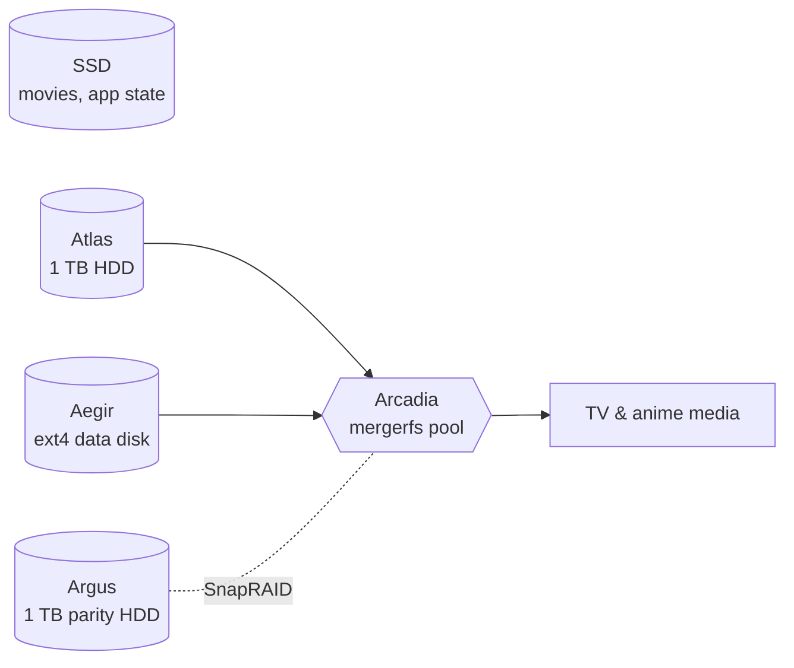
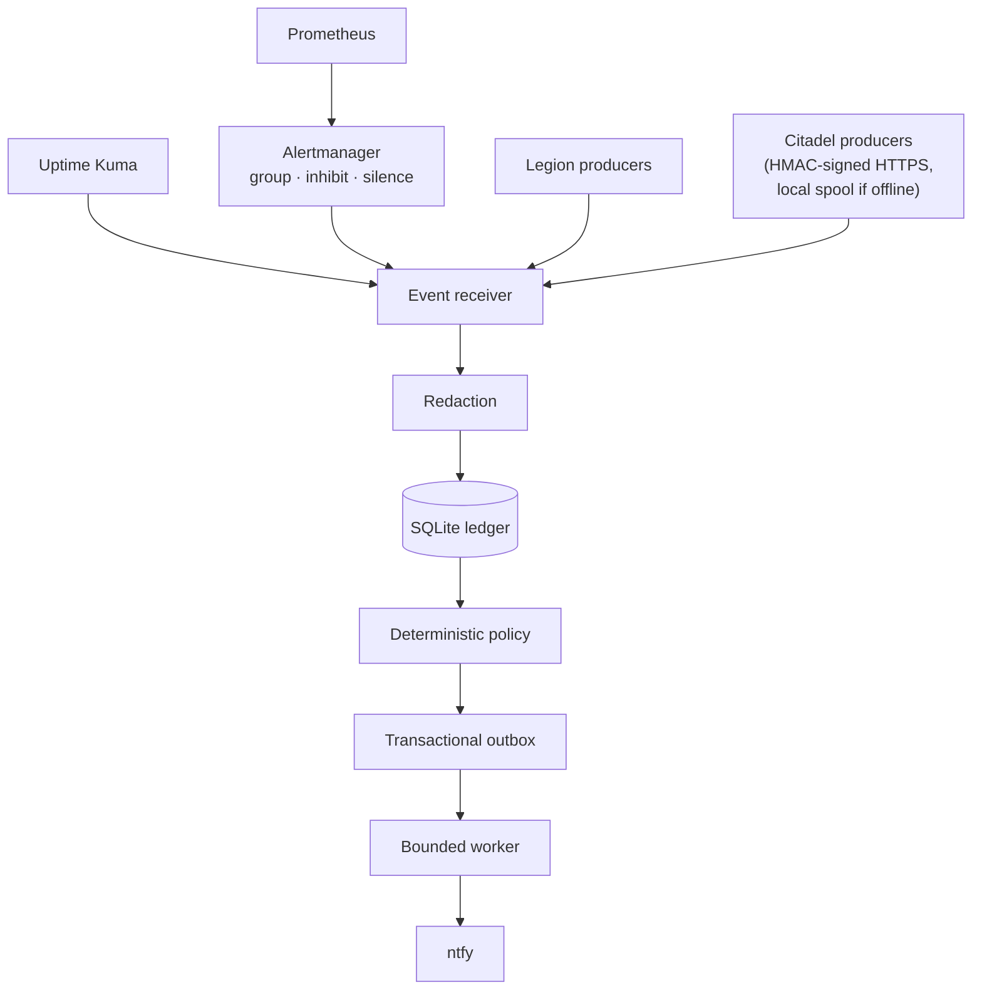

# Architecture

*Last reviewed 2026-11-08. Real addresses and domains are replaced with placeholders.*

Three machines, one tailnet. **Legion** runs almost everything, **Citadel** is a small always-on helper, and **Nexus** is a powerful workstation that is normally switched off.

## Overview

| Machine | Hardware | Role |
|---|---|---|
| **Legion** | Lenovo Legion laptop, Intel i5-9300H (4c/8t), GTX 1650, Ubuntu Server, headless | Primary server. Reverse proxy, media automation, photos, files, DNS, self-built apps, the whole monitoring pipeline |
| **Citadel** | HP laptop, Intel i3-8145U (2c/4t), CachyOS | Light appliance. Status wallboard, Wake-on-LAN and control scripts, a few monitoring containers |
| **Nexus** | Desktop PC, 32 GB RAM, RTX 5070 Ti | Occasional use: memory-hungry graph builds and a local LLM host |

Machines and disks have mythological names so any of them can be discussed without ambiguity. The Docker projects follow the same scheme: Legion's stack is `nidavellir`, Citadel's is `valhalla`.

## Legion

Legion runs Docker Compose, split into finite category files (`base`, `network`, `apps`, `media`, `storage`, `monitoring`, `ops`, `backups`) combined through `COMPOSE_FILE`. Each file stays small enough to review, and a service's category says what it depends on. The application list is long and unremarkable: Nginx Proxy Manager, a media server and its automation, Immich, Nextcloud, Karakeep, Actual Budget, Pi-hole, OpenTripPlanner, and a few self-built applications. The interesting parts are below.

Tuning is deliberately measured rather than maximal. The CPU is undervolted by a middle value, the HDDs have power management and read-ahead set from measurements, and zram is enabled. Each of those has a decision record with the numbers behind it.

### Storage

- **Atlas** and **Aegir** are independent ext4 disks. **Arcadia** is a mergerfs pool over both, placing new files on the disk with the most free space.
- The pool mount is guarded. A pre-start check refuses to mount Arcadia unless both backing disks are distinct, writable ext4 filesystems with the expected UUIDs. The pool is also bound to both backing mounts, so if one disappears the pool stops, and a missing disk is never mistaken for an empty directory on the SSD. The guard was tested against a missing mount, a wrong UUID, a read-only filesystem and a root-filesystem fallback.
- **Argus** sits outside the pool as the SnapRAID parity disk. Scheduled syncs and scrubs run, and the initial full verification completed on 2026-11-01.
- Compatibility symlinks keep application paths stable, so moving media onto the pool did not mean reconfiguring every app.
- Movies and application state stay on the SSD.
- Backups are verified with real checksums, not by trusting that the sync ran (see the backup verification records).

### Network and trust

The security model is DNS, not firewall rules.

- A public DuckDNS name and all its subdomains (`service.example.duckdns.org`) resolve to **Legion's Tailscale address**, not a public IP.
- Tailscale addresses (`100.64.0.0/10`) are not routable on the internet, so the name is meaningless to anyone who isn't already on the tailnet.
- Nginx Proxy Manager terminates TLS with a wildcard Let's Encrypt certificate (DNS-01 challenge) and routes by subdomain.
- Nothing is port-forwarded for the web services, so there is no way to expose something by accident. Making a service public would require an explicit port-forward, which does not exist.
- There is no extra authentication layer. Tailnet membership is the boundary, and that is an accepted trade-off for a household network.
- SSH is key-only on every machine. Each pair of machines has its own dedicated keypair.

**DNS for the tailnet** goes through Pi-hole on Legion. The tailnet's global nameserver points at it, which gives network-wide ad blocking and a single place to see queries.

One thing learned the hard way: after Pi-hole replaced the `systemd-resolved` stub listener, Tailscale switched to managing `/etc/resolv.conf` directly. `resolvectl query` then reported `resolved`'s own stale state rather than what applications actually see. Verify DNS routing with `getent hosts <name>` or Pi-hole's query log instead.

Docker container-name DNS is host-local, so a container on one machine can't resolve a container name on another. Cross-machine calls use the Tailscale address.

## Citadel

Citadel is intentionally small. A light Docker appliance runs Netdata, a Scrutiny collector, Watchtower, and an external health-check pinger. The status wallboard stays a native systemd service rather than a container because it needs direct display access.

- It stays up around the clock: lid-switch suspend is disabled.
- Its path to the LAN is Wi-Fi. A separate point-to-point Ethernet link runs only to Nexus, for Wake-on-LAN and fast transfers.
- Citadel wakes Nexus, never the other way round.
- Heavy or stateful applications belong to Legion. Watchtower is per-machine, so Legion's instance cannot see Citadel's Docker daemon.

## Nexus

A desktop PC that is **usually off**. It is switched on for tasks that need its memory, such as building a routing graph (a heap of up to 28 GB at build time versus 12 GB to serve it) and for running local LLM models on its GPU. Nothing in the homelab may assume Nexus is reachable. It is reachable over the LAN by an SSH alias even when Tailscale shows it offline.

## Monitoring and alerting

Metrics come from Netdata on each machine into Prometheus, with Grafana for dashboards and Uptime Kuma for service checks. A design goal was that a phone buzzing should always mean something.

- **Everything is recorded before anything is sent.** The receiver writes structured events and incident transitions to a local SQLite ledger first, and only then creates a notification intent.
- **One door to the phone.** Only the outbox worker publishes to the active ntfy topics. Producers writing to ntfy directly is forbidden on the live path.
- **Two active topics.** `homelab-critical` for rare, deterministic pages and `homelab-digest` for a morning health summary at 09:00 IST. Resolved callbacks are recorded and processed, but they never become standalone pages.
- **Bounded and honest delivery.** The worker handles one intent per run with a short HTTP timeout and stores only allow-listed response metadata. Delivery is at-least-once, not exactly-once, and the design says so.
- **Staged rollout.** The policy checked into the repo is a shadow baseline that records what it would send. Production delivery uses a separately installed policy, so a change to the repo alone does not turn paging on.
- **Prometheus and Alertmanager keep their jobs.** Prometheus evaluates, Alertmanager owns grouping, inhibition and silencing, and the receiver decides what a person is actually told.
- **Citadel going quiet is itself an alert.** A dedicated page covers Citadel becoming unreachable, and the morning digest lists open incidents.

## Lessons that shaped the design

Several of these are recorded in detail as decision records.

- **A label is not a fact.** A Prometheus `host` label is exactly what the scrape config says it is. A container-name target resolves to whichever machine runs the stack, so after a migration the dashboards showed plausible but wrongly labelled data instead of failing. The fix was to check what each target actually resolves to.
- **Single-file bind mounts go stale.** Replacing a script on the host gives it a new inode, and a container keeps the old copy until it is recreated. That caused a run of backup failures, and the recreate step is now in the runbook.
- **Cron time zones.** The distribution's `cron` ignores `CRON_TZ`, so jobs ran on raw UTC numbers. The fix was setting the system time zone, and the lesson was to verify scheduling against a real syslog timestamp.
- **Containers without `TZ` run in UTC.** A job at 04:00 in a container is 09:30 local time.
- **Verify, don't assume.** Several decisions exist because an assumption looked right and wasn't: a hardening option enabled on none of 19 proxy hosts, three CPU power tools silently fighting each other, and documentation describing machines that had since changed.
- **Manual over automatic on the gateway path.** Reverse-proxy redundancy is a runbook with a human in the loop. Automatic failover was rejected after working through the fail-back edge cases. The same caution applies to anything that could take the whole homelab offline at once.

## Where to go next

- [Decision records](decisions/README.md), the reasoning behind each choice above
- The runbooks, host pages and service notes are published in later phases (see the [roadmap](../README.md#roadmap))
